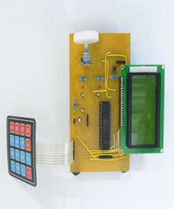

This is a proof of concept for a basic implementation using PIC16F1779 MCU from Microchip Technologies which has a plenty of analog features that could be very helpful to design an Electronic DC load that is affordable with acceptable features and performance.

-------------------- Project pictures----- v0--- now archive--

## Firmware

The firmware is being rebuilt step by step. See [Firmware/README.md](Firmware/README.md) for the
current state and the pins in use.

## License

This repo uses two licenses:

| Part | License |
|------|---------|
| Firmware (`Firmware/`) and the PC GUI (`gui.py`) | [MIT License](LICENSE) |
| Hardware design files (`Hardware/`: Altium schematics, PCB layouts, 3D models, block diagram) | [CERN Open Hardware Licence v2 – Permissive (CERN-OHL-P-2.0)](Hardware/LICENSE) |

Copyright (c) 2026 naifaljohani

### Use as is: no warranty, no liability

> [!WARNING]
> **The hardware designs and firmware are provided "AS IS", with no warranty of any kind.**
> This is a hobby proof of concept. It hasn't been certified or safety tested, and it is not guaranteed to work or to be fit for any purpose.
> An electronic DC load handles significant power and heat. **You build and use it entirely at your own risk.**
> The author accepts **no liability** for any damage, injury or loss that comes from using these files or any device made from them.
> This disclaimer is set out in section 5 of the CERN-OHL-P and in the MIT License.

Both licenses are permissive. You may use, modify, build, share and sell the design and the code, including commercially. You don't have to publish your changes, and you owe the author nothing. The only conditions are:
- keep the copyright and license notices
- if you share modified design files, note what you changed

## Use of AI tools

AI assistants were used during development, mainly to help write and
restructure firmware code and documentation. The hardware design (schematics,
PCB layout) was not AI-assisted.

All AI-assisted work was reviewed, built and tested on the real hardware.

This does not change the licenses or the "as is" disclaimer above: please
review and test the design yourself before relying on it.
